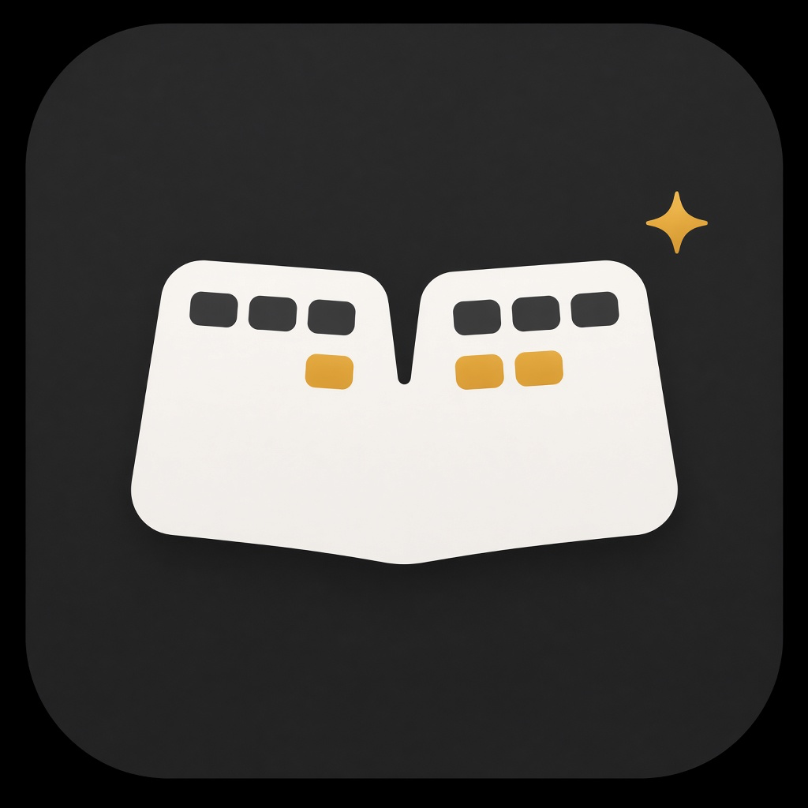

# ErgoKeys

Assigns the unused special keys on a Microsoft Natural Ergonomic Keyboard 4000 to real actions on a Mac.



macOS already handles mute, volume, and play/pause. Home, Search, Mail, Favorites 1–5, Calculator, and the Back/Forward arrows live on a second USB interface, so System Settings and Karabiner never see them. ErgoKeys reads that interface and runs the action you configure.

Typing, volume, and play/pause are left alone.

## Build

You need macOS 13 or later and the Xcode Command Line Tools (`xcode-select --install`).

```bash
git clone https://github.com/mosenberg/ErgoKeys.git
cd ErgoKeys
make install
```

`make install` builds a release binary, turns `assets/ergokeys-icon.png` into `assets/AppIcon.icns`, and installs `~/Applications/ErgoKeys.app`. The app icon is the one shown above. A login item starts it in the background, so it does not appear in the Dock.

Then, in **System Settings → Privacy & Security**, enable ErgoKeys for:

- **Input Monitoring**, so the special keys can be read
- **Accessibility**, so the arrow keys can switch the whole desktop

Restart after granting access:

```bash
~/Applications/ErgoKeys.app/Contents/MacOS/ergokeys restart
```

Check that the keyboard and permissions are visible:

```bash
.build/release/ergokeys selftest
~/Applications/ErgoKeys.app/Contents/MacOS/ergokeys doctor
```

## Default bindings

| Key | Action |
| --- | --- |
| Home | Lock the screen |
| Favorite 1 | Brightness down |
| Favorite 2 | Brightness up |
| Favorite 3 | Terminal |
| Favorite 4 | Google Chrome |
| Favorite 5 | Notes |
| Calculator | Calculator |
| Back (left arrow) | Previous desktop |
| Forward (right arrow) | Next desktop |
| Mail | Mail |

Search stays unbound. macOS often already opens Spotlight for that key, and a second binding would close it again.

The config is `~/Library/Application Support/ergokeys/config.json`. Saving the file reloads it.

```json
{
  "bindings": {
    "favorite-3": { "action": "open", "target": "/Applications/Spotify.app" },
    "favorite-5": { "action": "shell", "command": "open -a \"Visual Studio Code\"" },
    "search": { "action": "keystroke", "key": "space", "modifiers": ["command"] },
    "zoom-in": { "action": "desktop", "direction": "right" },
    "zoom-out": { "action": "desktop", "direction": "left" }
  }
}
```

Actions: `lock`, `brightness` (`delta`, one system step is `0.0625`), `open`, `desktop` (`left` or `right`), `keystroke`, `shell`.

## Find a key's name

If a key is not the name you expect, the zoom rocker for example:

```bash
~/Applications/ErgoKeys.app/Contents/MacOS/ergokeys listen
```

Each press prints a name such as `↓ back`. Put that name in the config. `listen` does not run the action.

The zoom rocker is `zoom-in` and `zoom-out` when it arrives as a consumer key, otherwise `extra-1` and `extra-2`.

## Other commands

```bash
~/Applications/ErgoKeys.app/Contents/MacOS/ergokeys edit
tail -f ~/Library/Logs/ergokeys.log
~/Applications/ErgoKeys.app/Contents/MacOS/ergokeys uninstall
```

`uninstall` removes the login item and the app. The config file stays.

The arrow keys send the macOS shortcut Control+Left and Control+Right, which changes the whole desktop rather than only the frontmost window.

## License

[MIT](LICENSE)
